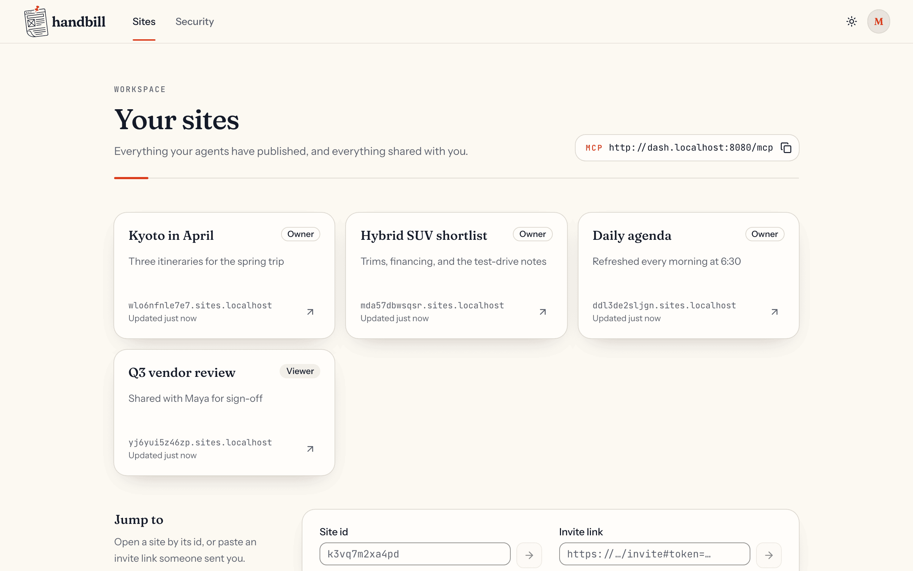
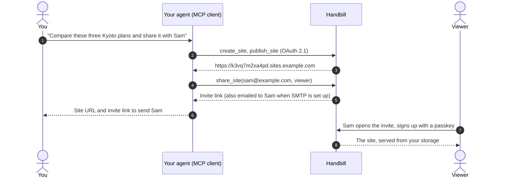
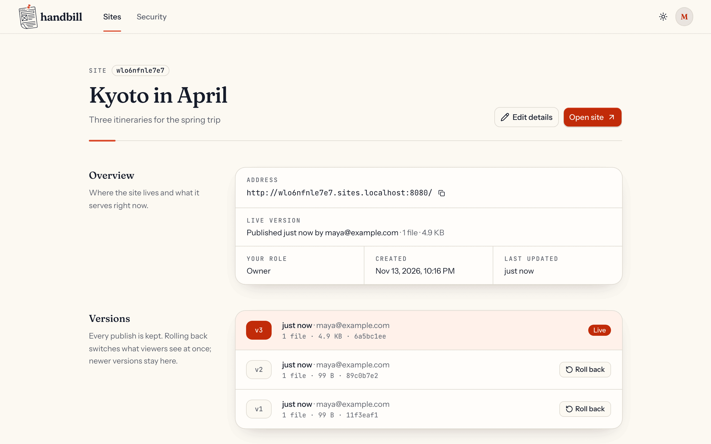
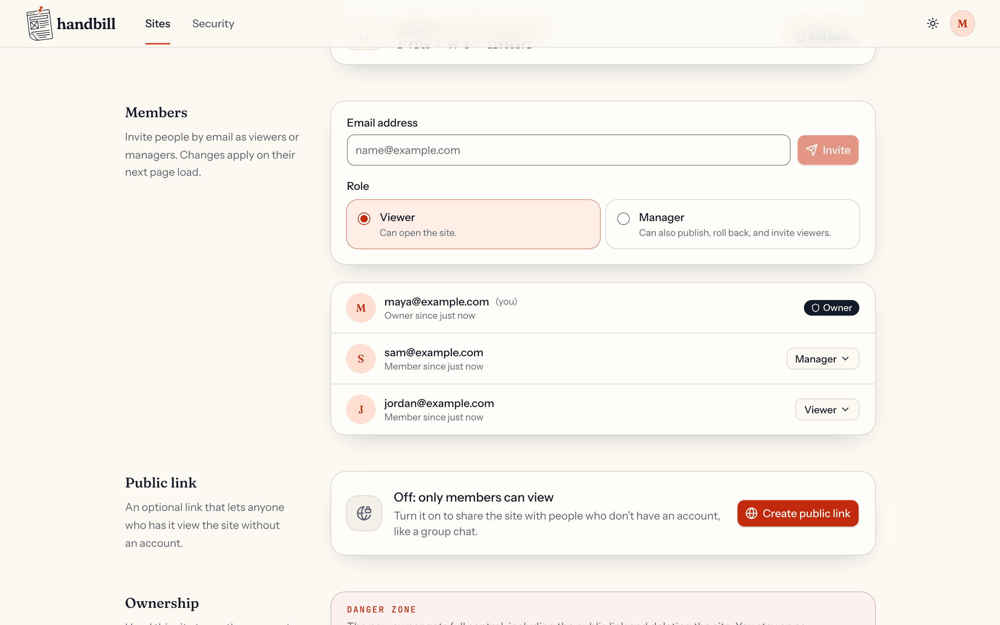
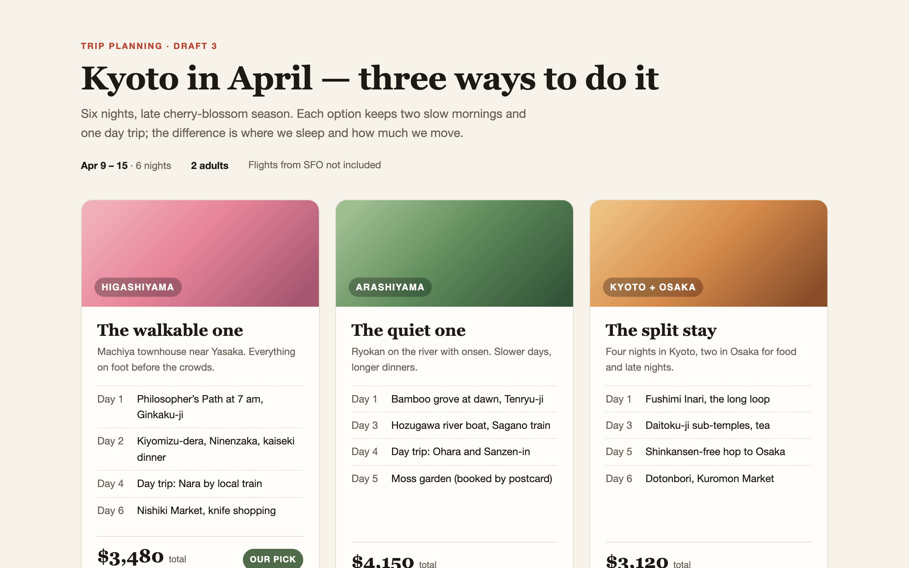
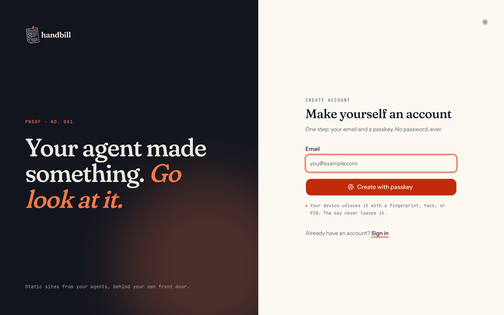
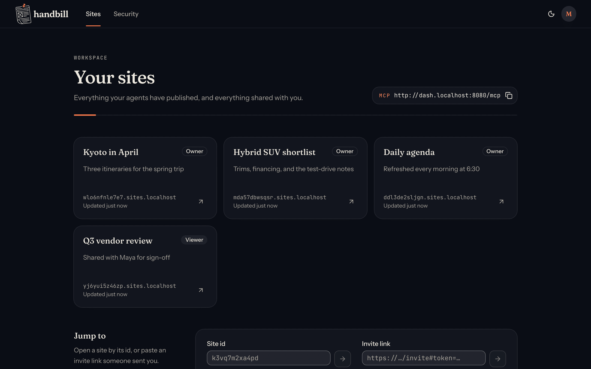

<p align="center">
  <picture>
    <source media="(prefers-color-scheme: dark)" srcset="docs/brand/svg/lockup-horizontal-reversed.svg">
    
  </picture>
</p>

<h3 align="center">Your agent made something. Go look at it.</h3>

<p align="center">
  Self-hosted, private hosting for the web pages your AI agents make.<br>
  Publish over MCP, share with a link, keep the data on your own infrastructure.
</p>

<p align="center">
  <a href="https://github.com/ferrule-io/handbill/releases/latest"></a>
  <a href="https://github.com/ferrule-io/handbill/actions/workflows/ci.yaml"></a>
  <a href="https://github.com/ferrule-io/handbill/pkgs/container/handbill"></a>
  <a href="#connect-your-agent"></a>
</p>

<p align="center">
  <a href="#quick-start">Quick start</a> ·
  <a href="docs/self-hosting.md">Self-hosting guide</a> ·
  <a href="#connect-your-agent">Connect your agent</a> ·
  <a href="#features">Features</a> ·
  <a href="docs/design.md">Design</a>
</p>

<p align="center">
  
</p>

---

## The problem

Agents are good at making things for people to look at: a trip itinerary to
show your partner, a comparison of three cars, a vendor review for your boss,
a dashboard of today's meetings. Getting that page in front of another person
is still awkward:

| Today you… | …and pay for it with |
|---|---|
| **Use a vendor's hosted artifacts** | The content (your finances, your family's plans, your client's data) sits on someone else's servers, outside your retention policy and your audit trail. It is tied to one chat app, and you can't get the content out or control who reads it. |
| **Open an ngrok tunnel** | Your laptop has to stay awake with a server running. The URL dies when the tunnel does, and anyone who has the URL can open it. |
| **Push to a static host** | The site is public by default, needs a repo and a pipeline, and is far too much ceremony for a page you'll throw away on Friday. |

**Handbill is an output endpoint you own.** Any agent that speaks
[MCP](https://modelcontextprotocol.io) publishes a static site to it in one
tool call. The person you're showing it to opens a stable, private URL, signs
in with a passkey, and sees it. Nothing has to keep running on your machine,
and nothing leaves your servers.

> A *handbill* is a printed notice handed out and then thrown away, like the
> sites Handbill hosts.

## Why Handbill

### Your data stays yours

- **No third-party hosting of artifact content.** Sites live in your
  PostgreSQL and your storage: a local volume, Amazon S3 (or any
  S3-compatible store such as MinIO or Cloudflare R2), or Google Cloud Storage,
  in the region and account you choose.
- **Your retention, your backups, your audit trail.** Every publish is a
  version you can list, roll back to, or delete along with the whole site.
- **One container, no phone-home.** The server makes outbound calls only to
  services you configure (SMTP, Google sign-in, your storage) and to fetch an
  MCP client's public metadata document during sign-in.
- **Not tied to one harness.** Claude Code, Claude Desktop and claude.ai,
  VS Code, or any MCP client publishes to the same place.

### Built for things you'll throw away

- **One call to publish.** `publish_site` takes the files and returns a URL.
  Larger sites, photos, and video go through staged uploads or a single
  `curl -T`.
- **A stable URL that updates in place.** Republish and viewers see the new
  version at the same address, which suits a dashboard an agent refreshes
  every morning.
- **Every version kept, one-step rollback.** A bad publish is one
  `rollback_site` away.
- **Gone when you say so.** `delete_site` removes every version, every file,
  all sharing, and the URL immediately. Abandoned uploads expire on their own,
  and unreferenced files are garbage-collected.

### Private by default

- **Nobody sees a site unless you share it.** Viewers sign in, and you grant
  each person a role per site: **owner**, **manager** (can publish and invite
  viewers), or **viewer**. Revoking access takes effect on their next request.
- **No passwords.** Accounts use passkeys, with optional Google sign-in and
  one-time recovery codes. Someone you invite can create an account and see
  the site in one step.
- **Optional "anyone with the link".** Turn it on for a group chat, then
  rotate or switch it off whenever you like; old links stop working at once.
- **Every site is quarantined on its own origin.** Each site gets a random
  subdomain (`k3vq7m2xa4pd.sites.example.com`) away from the app, so an
  agent's HTML and JavaScript can't read your session or act as you.
  Service workers are refused, and responses carry `nosniff`.
- **Secrets are hashed at rest.** Sessions, OAuth tokens, invites, public
  links, and recovery codes are stored only as hashes (recovery codes with
  argon2id).
- **Agents get scoped, revocable access.** Agents connect with OAuth 2.1 and
  PKCE through a consent screen, and you can disconnect any client from
  Settings → Security.
- **A hardened runtime.** The image is a distroless, non-root static binary
  with a read-only root filesystem, CSRF and Origin checks, a strict CSP on
  app pages, and per-route rate limits.

## How it works



## Features

<table>
<tr>
<td width="50%" valign="top">

**Publishing**
- MCP endpoint at `/mcp`: 21 tools for sites, versions, files, and sharing
- One-call `publish_site`, or staged deployments for big sites
- Raw single-file uploads (`curl -T video.mp4 <url>`) and `.tar.gz`/`.zip` uploads
- Replace or merge publishes; atomic finalize
- Up to 512 MiB per file and 1 GiB per site by default (configurable)

</td>
<td width="50%" valign="top">

**Viewing**
- Fast static file serving with ETags and clean URLs (`/about` → `about.html`)
- HTTP range requests, so video seeks and plays in Safari
- Custom `404.html` per site
- Light and dark themes in the app

</td>
</tr>
<tr>
<td valign="top">

**Sharing and accounts**
- Owner, manager, and viewer roles per site
- Invite links (emailed when SMTP is configured)
- Optional public links with rotation
- Ownership transfer
- Passkeys, Google sign-in, recovery codes

</td>
<td valign="top">

**Operations**
- One Docker image (`linux/amd64`, `linux/arm64`) with SLSA provenance and SBOM
- Helm chart with optional bundled PostgreSQL and Ingress
- Storage on a local volume, S3, or GCS
- Prometheus metrics, `/healthz` and `/readyz`, JSON logs
- Automatic migrations and background cleanup; scales to multiple replicas

</td>
</tr>
</table>

## A look inside

| | |
|---|---|
|  |  |
| **Every publish is a version.** Roll back with one click or one tool call. | **Share per person.** Viewers, managers, invites, and an optional public link. |
|  |  |
| **What your viewer sees:** the agent's page, nothing else. | **One-step sign-up.** An email and a passkey. |

<p align="center"></p>

## Quick start

Try Handbill on your own machine in about two minutes. You need Docker.

```bash
git clone https://github.com/ferrule-io/handbill.git
cd handbill/deploy/compose
cp .env.example .env
# Fill in the two required secrets:
sed -i.bak "s/^SECRET_KEY=$/SECRET_KEY=$(openssl rand -hex 32)/; s/^POSTGRES_PASSWORD=$/POSTGRES_PASSWORD=$(openssl rand -hex 16)/" .env
docker compose up -d
```

Open **<http://dash.localhost:8080>**, create an account with a passkey, and
copy the MCP URL from the dashboard. Sites appear at
`http://<site-id>.sites.localhost:8080`; browsers resolve `*.localhost` to your
own machine, so no DNS setup is needed.

## Self-host it for real

A production install needs two hostnames, a wildcard DNS record, and a
wildcard TLS certificate:

| Hostname | Serves |
|---|---|
| `handbill.example.com` | The app, sign-in, OAuth, and the MCP endpoint |
| `*.example-sites.com` | One subdomain per site |

Then pick a deployment:

- **Docker Compose on one VM**: [`deploy/compose`](deploy/compose) behind
  Caddy or nginx. [Guide →](docs/self-hosting.md#option-a-docker-compose-on-one-server)
- **Kubernetes**: the Helm chart, published as an OCI artifact.
  [Guide →](docs/self-hosting.md#option-b-kubernetes-with-helm) ·
  [Chart reference →](deploy/helm/handbill/README.md)

  ```bash
  helm install handbill oci://ghcr.io/ferrule-io/charts/handbill \
    --namespace handbill --create-namespace \
    --set app.origin=https://handbill.example.com \
    --set app.sitesDomain=example-sites.com
  ```
- **Any container platform**: run `ghcr.io/ferrule-io/handbill` with a few
  environment variables. [Guide →](docs/self-hosting.md#option-c-just-the-container)

The [self-hosting guide](docs/self-hosting.md) covers domains, TLS, storage,
email, Google sign-in, upgrades, backups, and troubleshooting.

## Connect your agent

The MCP endpoint is `<your app origin>/mcp`, shown with a copy button on the
dashboard. The first time an agent connects, Handbill asks you to sign in and
approve it.

**Claude Code**

```bash
claude mcp add --transport http handbill https://handbill.example.com/mcp
```

**Claude Desktop and claude.ai**: Settings → Connectors → *Add custom
connector*, then paste the MCP URL. Claude's connectors connect from
Anthropic's cloud, so the instance must be reachable from the internet.

**VS Code**: *MCP: Add Server…* → HTTP, then paste the MCP URL.

**Other clients**: Handbill identifies clients with
[Client ID Metadata Documents](https://datatracker.ietf.org/doc/draft-ietf-oauth-client-id-metadata-document/).
For a client that only supports Dynamic Client Registration, set
`OAUTH_DCR_ENABLED=true`.

Then just ask:

> Make a page comparing the three Kyoto itineraries, publish it to Handbill,
> and share it with sam@example.com.

### MCP tools

| Area | Tools |
|---|---|
| Sites | `list_sites` · `create_site` · `get_site` · `update_site` · `delete_site` |
| Publishing | `publish_site` · `create_deployment` · `upload_files` · `get_upload_url` · `finalize_deployment` |
| Content and versions | `list_files` · `read_file` · `list_versions` · `rollback_site` |
| Sharing | `list_members` · `share_site` · `set_member_role` · `revoke_access` · `set_public_link` · `transfer_ownership` |
| Account | `whoami` |

## Documentation

| Document | What's in it |
|---|---|
| [Self-hosting guide](docs/self-hosting.md) | Deploying, configuring, and operating Handbill |
| [Helm chart](deploy/helm/handbill/README.md) | Every chart value, ingress, database, storage, backup and restore |
| [Design](docs/design.md) | Architecture, the security model, the full configuration reference |
| [Intent](INTENT.md) | Why Handbill exists and the decisions behind it |
| [Brand](docs/brand/README.md) | Logo, colours, and typography |

## Development

Handbill is a Go server with an embedded, statically exported Next.js
frontend. Tool versions and the dev environment come from
[`mise.toml`](mise.toml).

```bash
mise install          # Go, Node, pnpm, Helm, kind, sqlc
make run              # build web + server, start PostgreSQL, run on http://dash.localhost:8080
make test             # Go tests (uses the Compose test database)
make lint             # go vet, ESLint, TypeScript
make e2e              # Playwright acceptance suite against a running server
```

The [workplan](docs/workplan.md) and [roadmap](docs/roadmap.md) describe how
the code is organized and built.

<p align="center">
  <br>
  
</p>
