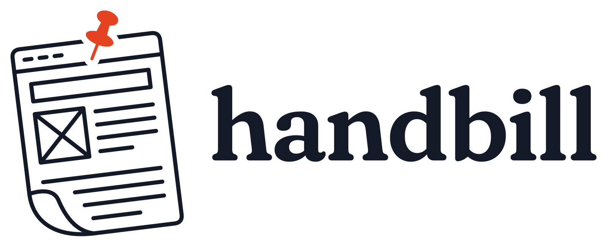

# Handbill brand pack

A handbill is a printed notice handed out and then thrown away, like the
sites Handbill hosts. The mark is a web page drawn as a sheet of US Letter
paper, pinned up and curling at the corner: something posted for people to
look at that is still a website.

This pack is the brand reference. It does not change the app: `web/` keeps
its own theme, `Mark` component, and `app/icon.svg`.

## Mark

| Element | Rule |
|---|---|
| Page | 8.5 : 11 (US Letter), never stretched to another ratio |
| Lean | 7° counter-clockwise (the top tips left) |
| Curl | Bottom-left corner lifts; the fold line shows the back of the sheet |
| Pin | Vermilion pushpin at the top centre, knocked out of the page lines |
| Content | Browser title bar with three dashes, headline box, image placeholder, text lines |
| Line | One monoline stroke weight with round caps and joins |

**Clear space:** keep at least the pin's height free on every side.
**Minimum size:** the full mark from 48 px tall; below that use the favicons,
which drop detail (`favicon.svg` for 24–48 px, `favicon-16.svg` for 16 px).

## Colour

The values are the sRGB equivalents of the app's theme tokens in
`web/app/globals.css`, so brand assets and the product match exactly.

| Role | Token | Light | Dark |
|---|---|---|---|
| Ink (lines, wordmark) | `--ink` / `--paper` in dark | `#131927` · `oklch(0.215 0.028 266)` | `#eee9e0` · `oklch(0.935 0.013 84)` |
| Paper (backgrounds) | `--paper` / `--ink` in dark | `#fcf9f2` · `oklch(0.982 0.009 84)` | `#0b0e15` · `oklch(0.165 0.016 266)` |
| Vermilion (pin only) | `--brand` | `#e54221` · `oklch(0.615 0.205 33)` | `#f5784b` · `oklch(0.71 0.165 40)` |

Vermilion is reserved for the pin. On dark backgrounds use the reversed
files, which swap ink and paper and use the dark-theme vermilion. Use
`mark-mono.svg` (`currentColor`) for single-colour reproduction: inlined, it
takes the surrounding text colour; loaded as an `` it renders black.

## Typography

| Use | Typeface | Setting |
|---|---|---|
| Wordmark | Fraunces | SemiBold (600), `SOFT` 100, `WONK` 1, `opsz` 24, tracking −0.025 em, lowercase **handbill** |
| Headings | Fraunces | As in the app (`--font-heading`) |
| Body / UI | Instrument Sans | `--font-sans` |
| Code | JetBrains Mono | `--font-mono` |

The wordmark files are outlined paths, so they render without the font
installed. The name is always lowercase in the wordmark and capitalised as
"Handbill" in running text.

## Files

| File | Use |
|---|---|
| `svg/mark.svg` | Full-colour mark on light backgrounds (transparent) |
| `svg/mark-reversed.svg` | Mark on dark backgrounds |
| `svg/mark-mono.svg` | Single colour via `currentColor` |
| `svg/wordmark.svg`, `svg/wordmark-reversed.svg` | Logotype alone |
| `svg/lockup-horizontal.svg` (+ `-reversed`) | Headers, README, docs |
| `svg/lockup-stacked.svg` (+ `-reversed`) | Square or narrow spaces |
| `svg/favicon.svg`, `svg/favicon-16.svg`, `svg/favicon-reversed.svg` | Browser tabs; the page is filled so it reads on light and dark tabs |
| `svg/app-icon.svg`, `svg/app-icon-dark.svg` | Rounded-square tiles (1024 grid) |
| `svg/og-image.svg` | 1200 × 630 social card |
| `png/favicon.ico` | 16, 32, 48 px |
| `png/favicon-{16,32,48}.png` | Raster favicons |
| `png/app-icon-{180,192,512}.png`, `png/app-icon-dark-512.png` | Apple touch icon, PWA icons |
| `png/mark-1024.png`, `png/mark-reversed-1024.png` | Raster mark |
| `png/lockup-horizontal-1600.png` (+ `-reversed`), `png/lockup-stacked-1024.png` | Raster lockups |
| `png/og-image.png` | Social card |

## Don't

- Re-tilt, flip, or straighten the page, or change its proportions.
- Recolour the pin, or use vermilion anywhere else in the mark.
- Add a tagline to the lockup.
- Set the wordmark in another typeface or in capitals.
- Place the full-colour mark on mid-tone or busy backgrounds; use the mono or
  reversed file instead.
