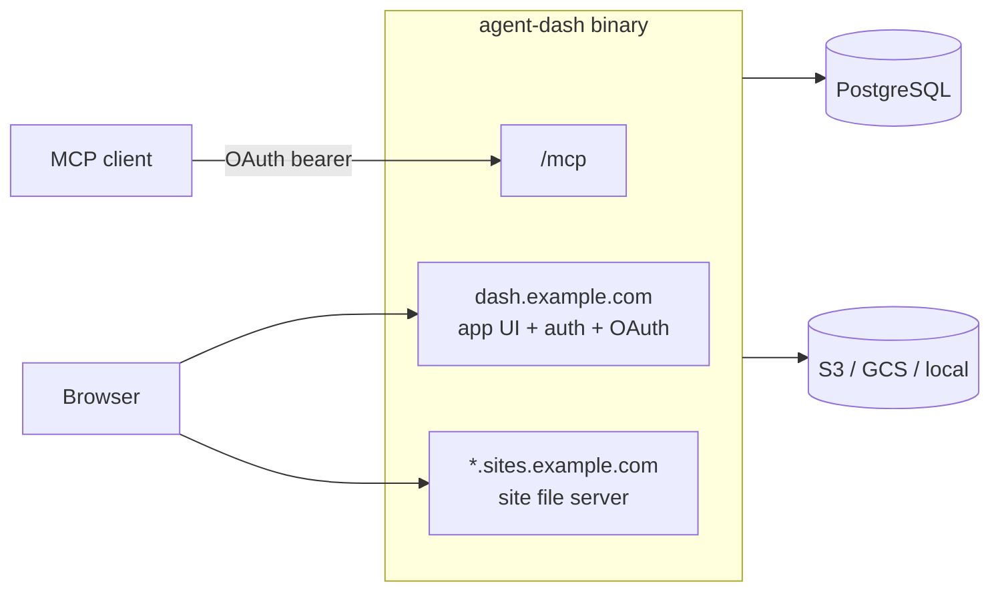

# agent-dash — Design

Decisions here implement [INTENT.md](../INTENT.md).

## Architecture

One Go binary, one container image. No Node.js at runtime.

The server routes by `Host`: `APP_ORIGIN` host serves the UI, auth, OAuth, and
`/mcp`; any `<id>.SITES_DOMAIN` host serves that site's files.

### Backend (Go)

| Concern | Choice |
|---|---|
| HTTP routing | `net/http` `ServeMux` |
| PostgreSQL | `pgx` with `sqlc`-generated queries |
| Migrations | `goose`, embedded, run at startup |
| Passkeys | `github.com/go-webauthn/webauthn` |
| Google sign-in | `github.com/coreos/go-oidc` + `golang.org/x/oauth2` |
| MCP | `github.com/modelcontextprotocol/go-sdk` (≥ 1.8) |
| OAuth 2.1 authorization server | In-house, limited to authorization code + PKCE, refresh tokens, CIMD, optional DCR |
| Storage | `aws-sdk-go-v2` (S3), `cloud.google.com/go/storage` (GCS), filesystem |

### Frontend (Next.js)

- Next.js App Router + TypeScript with `output: 'export'`; the build output is
  embedded into the Go binary with `embed`. No SSR, server actions, or
  middleware — all data comes from the Go JSON endpoints under `/app-api/`
  (session-cookie authenticated, CSRF-protected; internal to the UI, not a
  public API).
- Every UI route is a fixed path; there are no dynamic segments, because static
  export cannot serve `[id]` routes for IDs created at runtime (neither on direct
  load nor on client-side `<Link>` navigation, which fetches per-route RSC
  payloads). Parameters travel in the query string or fragment:
  `/site?id=<site-id>` and `/invite#token=<token>`. The client reads them with
  `useSearchParams` (inside `Suspense`) or `location.hash`.
- Go serves the export as files: `/<route>` → `<route>.html`, RSC payloads and
  assets as-is, unknown paths → the export's `404.html` with status 404. There
  is no catch-all HTML fallback.
- Acceptance check for the scaffold: with a site and an invite created at
  runtime, both a direct page load and client-side `<Link>` navigation to
  `/site?id=…` and `/invite#token=…` render correctly.
- Tailwind CSS + shadcn/ui; `@simplewebauthn/browser` for passkey ceremonies.
- Screens: sign-up, sign-in, recovery-code display and use, site list, site
  detail (overview, members and invites, public link, versions, transfer,
  delete), invite accept, OAuth consent, security settings (passkeys, Google
  link, recovery codes, OAuth grants).

### Site file server

No rendering. For a request on `<id>.SITES_DOMAIN`: authorize (site cookie or
handoff), resolve the path against the site's current version (`/` and
directory paths → `index.html`; missing → the site's `404.html` if present,
else a plain 404), and stream the object from storage with a content type from
the extension and an ETag derived from the version.

### Repository layout

| Path | Contents |
|---|---|
| `cmd/agent-dash/` | Server entrypoint |
| `internal/` | Go packages (http, auth, oauth, mcp, sites, storage, db) |
| `web/` | Next.js app |
| `deploy/helm/agent-dash/` | Helm chart |
| `Dockerfile` | Multi-stage: build `web/`, build Go with embedded assets, distroless runtime |

## Origins and URLs

Hosted sites contain agent-authored HTML and JS, so they never share an origin
with the app or with each other (URL option B).

| Surface | URL | Notes |
|---|---|---|
| App (UI, auth, OAuth, MCP) | `https://dash.example.com` | `APP_ORIGIN` |
| Site content | `https://<site-id>.sites.example.com/<path>` | `SITES_DOMAIN`; one wildcard cert for `*.sites.example.com` |

- `<site-id>` is random: 12 characters of lowercase base32 (`a-z2-7`, ~60 bits),
  assigned at creation and never changed. A wildcard cert covers a single label,
  so the id is always exactly one label. Sites have a title for display; the
  URL carries no owner or slug.
- The id is not a secret. Access is always enforced by the session or a
  public-link token (below).
- `/_auth/*` is reserved on every site host and never served from site content.

### App routes

| Route | Purpose |
|---|---|
| `/` | Sites the user owns, manages, or can view |
| `/site?id=<site-id>` | Settings, members, invites, public link, versions |
| `/invite#token=<token>` | Accept an invite or ownership transfer (signs up or signs in first). The token is in the fragment so it never reaches server or proxy logs. |
| `/signup`, `/login` | Passkey or Google |
| `/auth/google/callback` | Google OIDC callback |
| `/auth/site` | Issues site tickets (handoff below) |
| `/settings/security` | Passkeys, linked Google identity, recovery codes, OAuth grants |
| `/mcp` | MCP endpoint (OAuth bearer tokens only) |
| `/.well-known/oauth-protected-resource` | Protected resource metadata for `/mcp` |
| `/.well-known/oauth-authorization-server` | AS metadata, `client_id_metadata_document_supported: true` |
| `/oauth/authorize`, `/oauth/token` | OAuth 2.1 |
| `/oauth/register` | Dynamic Client Registration; only when `OAUTH_DCR_ENABLED=true` |
| `/api/deployments/<id>/archive` | Archive upload target returned by `get_upload_url` |
| `/app-api/*` | JSON endpoints for the UI only (session cookie + CSRF) |

### Site sign-in handoff

The app session cookie is host-only on `dash.example.com`; site hosts never
receive it.

1. A request to `https://<id>.sites.example.com/<path>` without a valid site
   cookie redirects to `https://dash.example.com/auth/site?site=<id>&return=<path>`.
2. The app requires a session (sign-in/sign-up if needed) and the viewer role,
   then redirects to `https://<id>.sites.example.com/_auth/callback?ticket=<t>`.
   The ticket is a random token bound to the site id and user, valid ~60 s,
   single use (stored hashed and consumed atomically on redemption).
3. The site host redeems the ticket, sets `__Host-site` (Secure, HttpOnly,
   SameSite=Lax, Path=/, host-only), and redirects to `<path>`.

Each site request loads the site's access state (current version, membership,
public-link enabled flag and generation) and re-checks the cookie against it,
so revocation, disabling, and rotation take effect on the next request.

### Public links

An owner can enable "anyone with the link" per site. The link is
`https://<id>.sites.example.com/_auth/share/<token>`; it sets a site cookie and
redirects to `/`, removing the token from the address bar. Rotating the token
invalidates the old link and every cookie issued from it. Disabling it reverts
the site to member-only.

### CSRF and CORS

Site hosts are same-site with the app (`*.example.com`), so `SameSite` cookies
do not stop an artifact from sending credentialed requests to the app. Required:

- Every state-changing request authenticated by the session cookie (including
  `/oauth/authorize` consent) checks `Origin` exactly equals `APP_ORIGIN` and
  validates a CSRF token.
- App cookies use the `__Host-` prefix so site hosts cannot set or overwrite them.
- Non-cookie endpoints are exempt from the Origin/CSRF check and never accept
  the session cookie: `/mcp` (bearer token), `/oauth/token` (PKCE/client
  authentication), and `/api/deployments/<id>/archive` (signed short-lived URL).
- No CORS response ever allows a site origin; credentialed CORS is limited to
  `APP_ORIGIN`.
- Site responses send `X-Content-Type-Options: nosniff`, no CORS headers, and
  `Referrer-Policy: no-referrer` on `/_auth/*`.

## Tokens and secrets

No bearer secret is stored in plaintext. The plaintext exists only in the
response that issues it.

| Secret | Generated as | Stored as |
|---|---|---|
| Session IDs, site tickets, OAuth authorization codes, access and refresh tokens, invite and ownership-transfer tokens, public-link tokens, email-verification tokens | 32 random bytes, base64url | SHA-256 of the token; looked up by hash. Single-use tokens (tickets, authorization codes, invites, transfers, verification) are consumed atomically. |
| Recovery codes | 16 base32 characters (80 bits), shown grouped | argon2id, compared per account; consumed atomically |
| Site cookies, signed upload URLs | HMAC-SHA256 with `SECRET_KEY`, carrying subject, site, expiry (site cookies from a public link also carry the link generation) | Not stored; validity also requires the current database state (role or link generation for cookies, an open deployment for upload URLs) |
| Google client secret, SMTP password, storage credentials | Configuration / Kubernetes Secret | Not in the database |

Consequences:

- Invite, ownership-transfer, and public links are shown only when issued.
  `get_site` and `list_members` report their state, never the link. To share
  again, re-issue the invite or `rotate` the public link.
- Rotating a public link bumps its generation. The per-request site lookup
  compares the cookie's generation with the current one, so cookies from the
  old link stop working immediately.

## Accounts

- Anyone can sign up and create sites.
- Sign-in methods: passkey (WebAuthn) or Google OIDC. No passwords.
- Email verification:
  - Google: verified when the ID token has `email_verified: true`.
  - Passkey sign-up: the typed email is unverified unless SMTP is configured and
    the user confirms a verification link.
- Google identities are linked to an existing account only explicitly, from
  `/settings/security` while signed in. A Google sign-in with a new `sub` creates
  a new account; if another account holds the same email unverified, that
  account loses the email claim.
- Recovery codes: 10 single-use codes generated at sign-up and shown once,
  stored hashed. A code signs the user in to register a new passkey.
  Regenerating invalidates all previous codes.

## Sharing

- `share_site` (or the UI) creates an invite for an email and role and always
  returns an invite link: `https://dash.example.com/invite#token=<token>`. With SMTP
  configured and `notify` set, the link is also emailed.
- The invite page keeps the token in `sessionStorage` across the sign-in or
  sign-up redirect (Google round trip), then accepts it with a CSRF-protected
  POST and clears it.
- The grant binds to whichever account accepts the invite link. It is applied
  automatically, without the link, only to an existing account whose matching
  email is verified.
- Invites are single use, expire after `INVITE_TTL` (default 14 days), and can
  be revoked while pending.

## Roles

| Action | Owner | Manager | Viewer |
|---|:-:|:-:|:-:|
| View site | ✓ | ✓ | ✓ |
| Publish, update files, roll back | ✓ | ✓ | |
| Edit title/description | ✓ | ✓ | |
| Invite/remove viewers | ✓ | ✓ | |
| Add/remove managers | ✓ | | |
| Enable/disable/rotate public link | ✓ | | |
| Transfer ownership | ✓ | | |
| Delete site | ✓ | | |

- Exactly one owner per site.
- Ownership transfer targets an email and completes when the recipient accepts
  (same binding rules and `INVITE_TTL` expiry as invites). The previous owner
  becomes a manager.

## Versions

Every publish creates an immutable version; the site serves its current
version. All previous versions are kept (no retention limit) and any can be
restored with `rollback_site`, which repoints the site (no copy). Publishing is
atomic: viewers see either the old version or the new one.

## MCP authorization

- OAuth 2.1 per the MCP authorization spec (2025-11-25), with PKCE (S256) and
  resource indicators binding tokens to `APP_ORIGIN/mcp`.
- Client registration via Client ID Metadata Documents (CIMD): the
  `client_id` is an HTTPS URL to the client's metadata JSON.
- Dynamic Client Registration (RFC 7591) is off by default. With
  `OAUTH_DCR_ENABLED=true`, `/oauth/register` is served and advertised as
  `registration_endpoint` in AS metadata. Registration is unauthenticated, so it
  is rate-limited, accepts only `https` or loopback `http` redirect URIs, and the
  consent screen labels DCR clients as unverified.
- CIMD fetching is an SSRF surface: HTTPS only, resolve and reject private,
  loopback, and link-local addresses, short timeout, response size cap, no
  redirects to disallowed hosts, cache per HTTP headers. Verify the document's
  `client_id` equals its URL and that the requested `redirect_uri` is listed.
- The consent screen shows the client name and the `client_id` host.
- Users review and revoke OAuth grants in `/settings/security`.

## MCP tools

`site` arguments take a site id. Roles are the minimum required.

| Tool | Purpose | Role |
|---|---|---|
| `whoami` | Caller's account | any |
| `list_sites` | Sites the caller owns or manages, with role and URL | any |
| `create_site` | Create from a title/description; returns id and URL | any |
| `get_site` | Metadata, URL, current version, public-link state, member count | manager |
| `update_site` | Title, description | manager |
| `delete_site` | Delete the site and its versions | owner |
| `transfer_ownership` | Start a transfer to an email; returns the acceptance link | owner |
| `publish_site` | One-shot atomic publish: `files[{path, content, encoding: utf8\|base64}]`, `mode: replace\|merge`, `delete_paths[]`, `notify` | manager |
| `create_deployment` | Start a staged publish (`mode: replace\|merge`); returns a deployment id | manager |
| `upload_files` | Add files to a staged deployment | manager |
| `get_upload_url` | Short-lived signed URL to upload a `.tar.gz`/`.zip` into a staged deployment | manager |
| `finalize_deployment` | Atomically publish a staged deployment as a new version | manager |
| `list_files` | Paths, sizes, content types in the current version | manager |
| `read_file` | Read one file from the current version | manager |
| `list_versions` | Versions with timestamps and publisher | manager |
| `rollback_site` | Make a previous version current | manager |
| `list_members` | Members, roles, pending invites | manager |
| `share_site` | Invite an email as viewer or manager; returns the invite link | manager (viewer), owner (manager) |
| `set_member_role` | Change a member between viewer and manager | owner |
| `revoke_access` | Remove a member or pending invite | manager (viewers), owner (managers) |
| `set_public_link` | `enable`, `disable`, or `rotate`; returns the link | owner |

## Storage

One adapter interface (`Store`) with `local`, `s3`, and `gcs` implementations.

Blobs are content-addressed and immutable:
`sites/<site-id>/blobs/<sha256-hex>`

Versions and deployments do not duplicate blobs; their file lists (path, blob
SHA-256, size, content type) are maintained in PostgreSQL (`version_files` and
`deployment_files`). Deleting a site deletes the entire storage prefix
`sites/<site-id>/` via `DeletePrefix`.

- `local`: Atomic writes via same-directory temp files, fsync, and rename.
  Content type stored in a `.meta` sidecar JSON. Enforces strict root isolation
  without following symlinks outside root via Go's `os.OpenRoot`.
- `s3`: Standard AWS SDK v2 client supporting AWS S3 and S3-compatible endpoints
  (e.g. MinIO). Handles pagination and batch deletions of up to 1000 objects.
- `gcs`: Google Cloud Storage client supporting Application Default Credentials
  and `STORAGE_EMULATOR_HOST` for testing.
- Key validation: all keys must be relative paths with no empty, `.`, or `..`
  segments, no backslashes, no leading slash, and no NUL bytes.

## Configuration

The server reads only environment variables. Invalid configuration fails
startup with one message listing every offending variable. The Helm chart
sets exactly these.

| Variable | Default | Meaning |
|---|---|---|
| `LISTEN_ADDR` | `:8080` | HTTP listen address |
| `APP_ORIGIN` | required | App origin, e.g. `https://dash.example.com`: scheme and host (optional port), no path |
| `SITES_DOMAIN` | required | Parent domain of site hosts, e.g. `sites.example.com`; must not contain the app host |
| `SECRET_KEY` | required | HMAC key for site cookies and upload URLs, at least 32 bytes |
| `DATABASE_URL` | empty | PostgreSQL URL or libpq key/value DSN. When empty, the libpq variables `PGHOST`, `PGPORT`, `PGUSER`, `PGPASSWORD`, `PGDATABASE`, `PGSSLMODE` are used |
| `STORAGE_TYPE` | `local` | `local`, `s3`, or `gcs` |
| `STORAGE_LOCAL_DIR` | `/data` | Root directory of the `local` adapter |
| `S3_BUCKET`, `S3_REGION` | required for `s3` | Bucket and region |
| `S3_ENDPOINT` | empty | Custom endpoint URL (e.g. MinIO) |
| `S3_PREFIX` | empty | Key prefix |
| `S3_FORCE_PATH_STYLE` | `false` | Path-style addressing (MinIO) |
| `GCS_BUCKET` | required for `gcs` | Bucket |
| `GCS_PREFIX` | empty | Key prefix |
| `SMTP_HOST` | empty | Mail server; notifications are disabled when empty |
| `SMTP_PORT` | by `SMTP_TLS`: 587, 465, 25 | Mail server port |
| `SMTP_USERNAME`, `SMTP_PASSWORD` | empty | Set both or neither |
| `SMTP_FROM` | required with `SMTP_HOST` | Sender, e.g. `agent-dash <dash@example.com>` |
| `SMTP_TLS` | `starttls` | `starttls`, `tls` (implicit TLS), or `none` |
| `GOOGLE_CLIENT_ID`, `GOOGLE_CLIENT_SECRET` | empty | Google sign-in; set both or neither (disabled when unset) |
| `OAUTH_DCR_ENABLED` | `false` | Serve `/oauth/register` (Dynamic Client Registration) |
| `INVITE_TTL` | `336h` | Lifetime of invites and ownership transfers (Go duration) |

- S3 credentials come from the AWS SDK default chain (environment, shared
  config, web identity / IRSA, instance role); GCS credentials from
  Application Default Credentials (including workload identity).
- Booleans accept Go's `strconv.ParseBool` forms (`true`, `false`, `1`, `0`).

Runtime contract:

- The container listens on port 8080 and runs as UID/GID 65532 (distroless
  `nonroot`); the `local` adapter writes under `/data`, which the image
  creates owned by that user.
- At startup the server applies pending migrations (serialized across
  replicas by an advisory lock) before listening, and exits non-zero if the
  database is unreachable; the orchestrator's restart policy retries it. The
  schema targets PostgreSQL 17 and later.
- `GET /healthz` (liveness: the process serves HTTP) and `GET /readyz`
  (readiness: the database and, once wired, storage answer within 3 s) respond
  on any `Host`, because Kubernetes probes use the pod IP. On site hosts they
  shadow site files at those two paths.
- Requests are routed by `Host` (port ignored): `APP_ORIGIN`'s host serves the
  app; `<id>.SITES_DOMAIN`, with `<id>` a valid site id, serves that site; any
  other host gets 404.
- Logs are JSON lines on stdout; query strings and `/_auth/` path tails are
  never logged.

Local development (`mise.toml` `[env]`, `compose.yaml`): the app runs on
`http://dash.localhost:8080`, sites on `http://<id>.sites.localhost:8080`
(browsers resolve `*.localhost` to loopback), and PostgreSQL on host port 55432.

## Deployment

### Image

One image containing the static Go binary with the embedded frontend, on a
distroless base, running as non-root.

### Helm chart

| Values | Behavior |
|---|---|
| `postgresql.enabled` (default `true`) | Bundled single-instance PostgreSQL StatefulSet (official `postgres` image) with a PVC. Intended for small installs. |
| `externalDatabase.*` | Used when `postgresql.enabled=false`: `host`, `port`, `database`, `user`, and `existingSecret`/`existingSecretPasswordKey`, or a full DSN via `existingSecret`. |
| `ingress.enabled` (default `false`) | Creates an Ingress with two rules: the app host and `*.<sitesDomain>`. `ingress.className`, `annotations`, and `tls` are configurable. |
| `storage.type` | `local`, `s3`, or `gcs`, with per-adapter settings; credentials from an existing Secret or workload identity. |
| `persistence.*` | PVC for the `local` adapter. |
| `smtp.*` | Optional; notifications are disabled when unset. |
| `google.*` | OAuth client ID and secret (from an existing Secret). |
| `oauth.dcrEnabled` (default `false`) | Maps to `OAUTH_DCR_ENABLED`. |

- Without the chart's Ingress, the operator routes both hostnames to the
  Service (their own Ingress, Gateway API, or a tunnel).
- The sites wildcard needs a wildcard TLS certificate; with cert-manager this
  requires a DNS-01 issuer.
- The `local` adapter with more than one replica requires a `ReadWriteMany`
  volume; otherwise use S3 or GCS.
