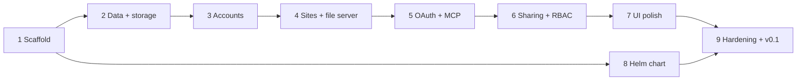

# agent-dash — Roadmap

Each step ends in something runnable and has an explicit done-when. Design
references are to [design.md](design.md).

Step 8 can run in parallel once the image builds. Step 5 is the first point
where the product is useful (an agent publishes; the owner views).

## 1. Scaffold

- Go module, `cmd/agent-dash`, `internal/` packages, config from environment
  (`APP_ORIGIN`, `SITES_DOMAIN`, `SECRET_KEY`, `DATABASE_URL`, storage, SMTP,
  Google, `OAUTH_DCR_ENABLED`, `INVITE_TTL`).
- Host-based routing: app host vs `<id>.SITES_DOMAIN`; `/healthz`, `/readyz`.
- `web/`: Next.js + TypeScript, `output: 'export'`, Tailwind, shadcn/ui, and the
  design system (typography, color tokens, layout primitives) so every later
  screen starts styled.
- Go embeds and serves the export per design (no catch-all fallback).
- Multi-stage `Dockerfile` to a distroless non-root image.
- Dev environment: `mise.toml` (Go, Node, pnpm), Compose file for PostgreSQL,
  app on `dash.localhost`, sites on `*.sites.localhost`.
- CI: Go vet/test, frontend lint/typecheck/build, image build.

**Done when:** the image runs locally; the routing acceptance check in design
(direct load and `<Link>` navigation to `/site?id=…` and `/invite#token=…`)
passes with IDs chosen at runtime.

## 2. Data model and storage

- Schema and `goose` migrations: users, emails, passkey credentials, Google
  identities, sessions, recovery codes, sites, versions, version files,
  deployments, memberships, invites, ownership transfers, public links, OAuth
  clients, authorization codes, access/refresh tokens.
- `sqlc` queries; token hashing helpers (SHA-256 lookup tokens, argon2id
  recovery codes, HMAC-signed tickets/cookies).
- Storage adapter interface plus local, S3, and GCS implementations, sharing
  one contract test suite (MinIO and fake-gcs-server in CI).

**Done when:** migrations apply on a fresh database; the adapter contract suite
passes against all three backends.

## 3. Accounts and sessions

- Passkey sign-up and sign-in (WebAuthn), Google OIDC sign-in, explicit Google
  linking in settings.
- Recovery codes issued at sign-up and usable to register a new passkey.
- Sessions (`__Host-` cookie), CSRF tokens + exact `Origin` checks on
  cookie-authenticated mutations.
- Optional SMTP: mail sender, email verification; everything works without it.
- UI: sign-up, sign-in, recovery-code display/use, security settings.

**Done when:** a new user signs up with a passkey and, separately, with Google;
signs out and back in; recovers with a code; a cross-site POST without a valid
`Origin` and CSRF token is rejected.

## 4. Sites and the file server

- Site creation with random 12-character ids; versions; staged deployments with
  atomic finalize; rollback by repointing.
- Site file server on `<id>.SITES_DOMAIN`: path resolution, `index.html`,
  `404.html`, content types, ETags, security headers.
- Site sign-in handoff (`/auth/site` → `/_auth/callback` ticket → `__Host-site`
  cookie), per-request role check.
- Owner-only access at this step; UI: site list and site detail (overview,
  versions).

**Done when:** a multi-page site with assets, published through an internal
call, is viewable by its owner, invisible to another signed-in user, and a
rollback switches content atomically.

## 5. OAuth 2.1 and MCP

- Authorization server: protected-resource and AS metadata, authorize + consent
  UI, token endpoint, refresh, PKCE (S256), resource indicators.
- CIMD client fetching with the SSRF guards; optional DCR behind
  `OAUTH_DCR_ENABLED`.
- `/mcp` with the official Go SDK; site and content tools: `whoami`,
  `list_sites`, `create_site`, `get_site`, `update_site`, `delete_site`,
  `publish_site`, `create_deployment`, `upload_files`, `get_upload_url`,
  `finalize_deployment`, `list_files`, `read_file`, `list_versions`,
  `rollback_site`.
- Archive upload endpoint behind signed URLs.
- Grant review and revocation in security settings.

**Done when:** Claude Code and Claude Desktop each connect to `/mcp` through
OAuth with CIMD, create a site, publish and update it, and the owner views it
in a browser.

## 6. Sharing and RBAC

- Role enforcement (owner, manager, viewer) across UI, `/app-api`, MCP, and the
  file server per the roles table.
- Invites (link always returned, optional email), acceptance with
  verified-email auto-binding, revocation, `INVITE_TTL` expiry.
- Public links (enable, disable, rotate with generation-based cookie
  invalidation).
- Ownership transfer with acceptance.
- MCP tools: `list_members`, `share_site`, `set_member_role`,
  `revoke_access`, `set_public_link`, `transfer_ownership`; `notify` on
  `publish_site`.
- UI: members and invites, public link, transfer, invite accept.

**Done when:** an agent shares a site with a new email; the invitee opens the
link, signs up in one or two steps, and views the site; a manager can publish
but not add managers; revocation takes effect on the next request; a rotated
public link stops working, including for already-issued cookies.

## 7. UI polish

- Visual pass over every screen: empty states, loading and error states,
  responsive layout, dark mode, keyboard and screen-reader accessibility.
- OAuth consent and invite-accept screens get particular care: they are the
  first thing a new viewer or client sees.

**Done when:** every screen is reviewed in a browser at mobile and desktop
widths with no unstyled or placeholder states.

## 8. Helm chart

- Deployment, Service, ConfigMap/Secret wiring, probes, resource defaults,
  non-root security context.
- Optional bundled PostgreSQL (`postgresql.enabled`) or `externalDatabase.*`.
- Optional Ingress (`ingress.enabled`) with app host and `*.<sitesDomain>`.
- `storage.*`, `persistence.*`, `smtp.*`, `google.*`, `oauth.dcrEnabled`.
- Install docs: wildcard DNS, wildcard TLS (DNS-01), routing without the
  chart's Ingress.

**Done when:** `helm install` in kind succeeds with the bundled database and
with an external one, with ingress on and off, and the app serves a site.

## 9. Hardening and v0.1

- Limits: request body, per-file and per-site size, file count, MCP payloads,
  rate limits on auth, OAuth, DCR, and invites.
- Security review against design: CSRF, SSRF (CIMD), cookie scoping, headers,
  token hashing, authorization on every path.
- Structured logs (no tokens or fragments logged), metrics endpoint.
- Backup and restore notes for PostgreSQL and storage.
- Multi-arch image publishing and a tagged chart release.

**Done when:** the review's findings are fixed, and v0.1 image and chart are
published.
