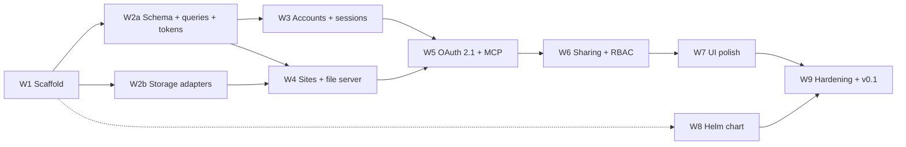

# agent-dash — Workplan

How the [roadmap](roadmap.md) is split into parallel workstreams, what each
one owns, and the Go interfaces at their boundaries. Workers code against
these signatures; changing one is a cross-workstream decision, recorded here
first. Design references are to [design.md](design.md).



W1 ‖ W8; W2a ‖ W2b; W3 ‖ W4; then W5, W6, W7, W9 in order.

| Workstream | Roadmap step |
|---|---|
| W1 | 1 Scaffold |
| W2a, W2b | 2 Data model and storage |
| W3 | 3 Accounts and sessions |
| W4 | 4 Sites and the file server |
| W5 | 5 OAuth 2.1 and MCP |
| W6 | 6 Sharing and RBAC |
| W7 | 7 UI polish |
| W8 | 8 Helm chart |
| W9 | 9 Hardening and v0.1 |

## Conventions for every workstream

### Route registration

The root handler (`internal/server`) routes by `Host` to two muxes and never
changes for a feature. Each feature package exports one module function:

```go
// internal/<feature>/routes.go
func Register(r *server.Routes, d *server.Deps) error {
	r.App.Handle("GET /auth/site", ...)       // app host
	r.Sites.Handle("GET /_auth/callback", ...) // <id>.SITES_DOMAIN; server.SiteID(ctx)
	return nil
}
```

and adds itself to the server from its **own** file in `cmd/agent-dash/`:

```go
// cmd/agent-dash/module_<feature>.go
package main

import "github.com/mjquinlan2000/agent-dash/internal/<feature>"

func init() { modules = append(modules, <feature>.Register) }
```

- Never edit `internal/server/server.go`, `cmd/agent-dash/modules.go`, or
  another workstream's `module_*.go`.
- Patterns are Go `ServeMux` patterns with methods (`"POST /oauth/token"`).
  The most specific pattern wins regardless of registration order; conflicts
  panic at startup (caught by any test that builds the handler). `webui`
  owns `GET /` on the app mux as the least specific pattern.
- Cross-cutting request wrapping uses `r.UseApp(mw)` / `r.UseSites(mw)`
  (first registered runs outermost). Only W3 (session) and W9 (rate limits,
  metrics) are expected to use them.
- `/healthz` and `/readyz` are answered by `internal/server` on any host
  before host routing; `readyz` pings `Deps.DB` and `Deps.Storage`.

### Shared dependencies

```go
// internal/server
type Deps struct {
	Config  *config.Config  // validated env, docs/design.md#configuration
	Logger  *slog.Logger    // JSON; never log tokens, query strings, fragments
	DB      *pgxpool.Pool   // lazy pool; migrations applied by db.Open (W2a)
	Storage storage.Store   // set in main by W2b
}
```

Feature services are constructed from `Deps` by whoever needs them
(`sites.NewService(d)`); they are stateless over the pool and store, so
several instances are fine. There is no global registry or DI container.

### Identity

`internal/identity` (exists) is the only way a package learns who is signed
in. W3's session middleware sets it on app-host requests; everyone else reads
it, and tests inject it with `identity.WithUser`.

```go
type User struct { ID uuid.UUID; Email string; EmailVerified bool }
func WithUser(ctx context.Context, u User) context.Context
func FromContext(ctx context.Context) (User, bool)
```

A page or endpoint that needs a signed-in user and has none redirects to
`/login?return=<url-encoded same-origin path+query>` (pages) or answers
`401` JSON (`/app-api`). The login and sign-up pages honor `return` only
for relative paths starting with a single `/`.

### IDs and types

- User, session, version, deployment, invite, and OAuth row ids are `uuid`
  (`github.com/google/uuid`, mapped in sqlc overrides).
- Site ids are `text` with `CHECK (id ~ '^[a-z2-7]{12}$')`, generated by
  `siteid.New()` (exists) and validated by `siteid.Valid`.
- Timestamps are `timestamptz` ↔ `time.Time`.
- Site origins come from `Config.SiteOrigin(id)` (exists).

### Database changes

- All SQL lives in `internal/db/migrations/` (goose, embedded) and
  `internal/db/queries/<area>.sql` (sqlc). Generated code is committed.
- W2a writes the whole step-2 schema. Later workstreams add migrations only
  for genuinely new needs, named with goose's timestamp versions
  (`goose create <name> sql`) so parallel branches never collide, and add
  queries in their own `queries/<area>.sql` file.

### Frontend

- Fixed routes only; parameters in the query (`useSearchParams` inside
  `Suspense`) or fragment (`useHash` from `web/lib/params.ts`). A new screen
  is a new fixed route and is added to the design's route table.
- Use the design tokens and primitives: `components/layout/*` (`AppShell`,
  `AuthShell`, `Container`, `Stack`, `PageHeader`, `Section`,
  `EmptyState`), `components/brand/*`, `components/ui/*` (shadcn, add with
  `pnpm dlx shadcn@latest add <name>`). No new raw colors; extend tokens in
  `app/globals.css` only in W7 or by agreement.
- Each workstream owns its page directories and `components/<area>/`.
- Playwright specs live in `web/e2e/<area>.spec.ts` and run against the real
  Go binary (`BASE_URL`), never `next dev`.

### Files several workstreams touch

Expect small, mechanical merges in: `go.mod`/`go.sum`,
`web/package.json`/`web/pnpm-lock.yaml`, `compose.yaml`,
`.github/workflows/ci.yaml`, `docs/design.md`, and the one storage line in
`cmd/agent-dash/main.go` (W2b only). Keep those edits minimal and separate
from feature commits.

## W1 Scaffold — done

Owns: `cmd/agent-dash/` (`main.go`, `modules.go`, `module_webui.go`),
`internal/config`, `internal/server`, `internal/siteid`,
`internal/identity`, `internal/webui`, `internal/storage/storage.go`
(interface), `internal/db/db.go` (`Open`), `web/` scaffold and design system
(`app/layout.tsx`, `app/globals.css`, `app/not-found.tsx`,
`components/{ui,layout,brand,theme}`, `lib/{utils,params}.ts`,
`e2e/routing.spec.ts`), `Dockerfile`, `.dockerignore`, `compose.yaml`,
`mise.toml`, `Makefile`, `.github/workflows/ci.yaml`.

Placeholder screens that later workstreams replace: `app/(app)/page.tsx`
and `components/home/*` (W4), `app/(app)/site/` and `components/site/*`
(W4, W6), `app/signup`, `app/login`, `app/(app)/settings/security`,
`components/auth/sign-in-options.tsx` (W3), `app/invite`,
`components/auth/invite-accept.tsx` (W6). Keep the `data-testid`s used by
`e2e/routing.spec.ts` (`site-id`, `invite-token-tail`, `not-found`) or update
the spec in the same change.

## W8 Helm chart

Owns: `deploy/helm/agent-dash/` and its install docs. Consumes the
configuration and runtime contract in design.md#configuration (env vars,
port 8080, UID/GID 65532, `/data`, probes on any `Host`).

## W2a Schema, migrations, queries, token helpers

Owns: `internal/db/` (`migrations/`, `queries/`, `sqlc.yaml`, generated
code, `db.go`), `internal/db/dbtest/`, `internal/token/`. Adds a PostgreSQL
service to the CI Go job.

Provides:

```go
package db

// Open creates the pool and applies the embedded goose migrations
// (replaces the step-1 version; signature unchanged).
func Open(ctx context.Context, cfg *pgxpool.Config) (*pgxpool.Pool, error)

// Queries is sqlc-generated; New accepts the pool or a pgx.Tx.
func New(db DBTX) *Queries

// InTx runs fn in a transaction, committing when it returns nil.
func InTx(ctx context.Context, pool *pgxpool.Pool, fn func(q *Queries) error) error
```

```go
package dbtest

// Pool returns a pool on a fresh, migrated database (TEST_DATABASE_URL,
// e.g. the Compose instance) dropped at test cleanup; skips when unset
// locally, fails when unset in CI.
func Pool(t *testing.T) *pgxpool.Pool
```

```go
package token

// Lookup tokens (sessions, tickets, codes, access/refresh, invites,
// transfers, public links, email verification): 32 random bytes, base64url.
func New() (plaintext string, hash []byte)
func Hash(plaintext string) []byte // SHA-256, for lookup by hash

// Recovery codes: 16 base32 chars shown as XXXX-XXXX-XXXX-XXXX; argon2id.
func NewRecoveryCode() string
func HashRecoveryCode(code string) (string, error) // PHC-encoded argon2id
func VerifyRecoveryCode(encoded, code string) bool // case/dash-insensitive

// HMAC-SHA256 with SECRET_KEY, domain-separated by purpose.
type Signer struct{ /* unexported */ }
func NewSigner(secret []byte) *Signer

type SiteCookie struct {
	SiteID     string
	UserID     uuid.UUID // uuid.Nil for a public-link cookie
	LinkGen    int64     // public-link generation; 0 for member cookies
	Expires    time.Time
}
func (s *Signer) SiteCookie(c SiteCookie) string
func (s *Signer) ParseSiteCookie(v string, now time.Time) (SiteCookie, error)

type UploadGrant struct {
	DeploymentID uuid.UUID
	SiteID       string
	Expires      time.Time
}
func (s *Signer) UploadGrant(g UploadGrant) string
func (s *Signer) ParseUploadGrant(v string, now time.Time) (UploadGrant, error)
```

Schema notes: every token column is `bytea` holding the SHA-256 and is
unique. Single-use consumption is one statement
(`UPDATE … SET consumed_at = now() WHERE token_hash = $1 AND consumed_at IS
NULL AND expires_at > now() RETURNING …`). Version files reference
content-addressed blobs (below), so the schema has
`version_files(version_id, path, blob_sha256, size, content_type)` and
`deployment_files` with the same shape plus deletions for merge mode.

Done when: migrations apply on a fresh database; `dbtest` and `token` have
unit tests.

## W2b Storage adapters — done

Owns: `internal/storage/` (interface exists; adds `Open`, `ValidKey`,
`local/`, `s3store/`, `gcsstore/`, `storagetest/`), the `deps.Storage`
line in `cmd/agent-dash/main.go`, MinIO and fake-gcs-server services in
`compose.yaml` (profile `storage`) and CI.

Interface (exists in `internal/storage/storage.go`):

```go
type Store interface {
	Put(ctx context.Context, key string, r io.Reader, size int64, contentType string) error
	Get(ctx context.Context, key string) (*Object, error) // ErrNotFound
	Stat(ctx context.Context, key string) (Info, error)   // ErrNotFound
	Delete(ctx context.Context, key string) error         // missing key is not an error
	DeletePrefix(ctx context.Context, prefix string) error
	Ping(ctx context.Context) error
}
```

Provides:

```go
func Open(ctx context.Context, cfg config.Storage) (Store, error)
func ValidKey(key string) error // relative, no "", ".", ".." segments, no backslash
package storagetest
func Run(t *testing.T, newStore func(t *testing.T) storage.Store)
```

Done when: the contract suite passes against local, S3 (MinIO), and GCS
(fake-gcs-server) in CI.

## W3 Accounts and sessions

Owns: `internal/auth/` (WebAuthn, Google OIDC, sessions, recovery codes,
email verification), `internal/appapi/`, `internal/mail/`, routes
`/auth/google/callback` and `/app-api/auth/*`, `/app-api/me`; web
`app/signup`, `app/login`, `app/(app)/settings/security`,
`components/auth/*` (except `invite-accept.tsx`), `components/settings/*`,
`lib/api.ts`; the account controls in `components/layout/app-shell.tsx`.

Provides:

```go
package auth
// Register installs routes and, via r.UseApp, the session middleware that
// loads the __Host-session cookie into identity.WithUser.
func Register(r *server.Routes, d *server.Deps) error
// SignOut and session revocation for other packages (e.g. account deletion).
func RevokeSessions(ctx context.Context, q *db.Queries, userID uuid.UUID) error
```

```go
package appapi
// Handle registers a JSON endpoint on the app mux. Every request needs a
// session unless Public() is passed; unsafe methods also require
// Origin == APP_ORIGIN and a valid X-CSRF-Token header.
func Handle(r *server.Routes, d *server.Deps, pattern string, h Handler, opts ...Option)
type Handler func(w http.ResponseWriter, r *http.Request) error
func Public() Option
// Error is rendered as {"error": {"code": ..., "message": ...}} with Status.
type Error struct { Status int; Code, Message string }
func (e *Error) Error() string
func WriteJSON(w http.ResponseWriter, status int, v any)
func ReadJSON(r *http.Request, v any) error // size-capped, unknown fields rejected
```

`GET /app-api/me` returns `{"user": {…} | null, "csrfToken": "…"}`; the UI
sends the token in `X-CSRF-Token`. `appapi` also claims `/app-api/` so
unknown endpoints get a JSON 404 instead of the UI's 404 page.

```go
package mail
type Message struct { To, Subject, Text, HTML string }
type Sender interface {
	Enabled() bool // false when SMTP_HOST is unset
	Send(ctx context.Context, m Message) error
}
func New(cfg *config.SMTP) Sender // nil cfg → Enabled() false, Send returns ErrDisabled
```

Notes: `__Host-` cookies require `Secure`; browsers accept Secure cookies on
`http://*.localhost`, so dev works over HTTP.

## W4 Sites, versions, publish pipeline, file server

Owns: `internal/sites/` (service), `internal/rbac/`, `internal/siteserver/`
(sites-mux file server and `/_auth/callback`), route `GET /auth/site`,
`/app-api/sites…` (list, get, update, versions, rollback); web
`app/(app)/page.tsx`, `app/(app)/site/`, `components/home/*`,
`components/site/*` (overview, versions).

Storage layout: `sites/<site-id>/blobs/<sha256-hex>` (content-addressed per
site, so merge publishes and rollbacks copy rows, not objects); deleting a
site deletes the prefix `sites/<site-id>/`. Abandoned-deployment blob GC is
W9.

Provides:

```go
package rbac
type Role string
const (Owner Role = "owner"; Manager Role = "manager"; Viewer Role = "viewer")
type Action string
const (
	View Action = "view"; Publish Action = "publish"; EditMeta Action = "edit_meta"
	ManageViewers Action = "manage_viewers"; ManageManagers Action = "manage_managers"
	ManagePublicLink Action = "manage_public_link"; Transfer Action = "transfer"
	Delete Action = "delete"
)
func Can(role Role, a Action) bool // the full design roles table
```

```go
package sites
type Service struct{ /* unexported */ }
func NewService(d *server.Deps) *Service

type Site struct {
	ID, Title, Description string
	OwnerID                uuid.UUID
	CurrentVersionID       uuid.NullUUID
	CreatedAt, UpdatedAt   time.Time
}
type Membership struct { Site Site; Role rbac.Role }
type Mode string // "replace" | "merge"
type File struct { Path, ContentType string; Body []byte }

func (s *Service) Create(ctx context.Context, owner uuid.UUID, title, description string) (Site, error)
func (s *Service) Get(ctx context.Context, id string) (Site, error) // ErrNotFound
func (s *Service) Update(ctx context.Context, id string, title, description *string) (Site, error)
func (s *Service) Delete(ctx context.Context, id string) error
func (s *Service) ListForUser(ctx context.Context, user uuid.UUID) ([]Membership, error)
func (s *Service) Role(ctx context.Context, siteID string, user uuid.UUID) (rbac.Role, error) // "" when none

// Staged publishing; Publish is the one-shot form.
func (s *Service) CreateDeployment(ctx context.Context, siteID string, by uuid.UUID, mode Mode) (uuid.UUID, error)
func (s *Service) AddFiles(ctx context.Context, deployment uuid.UUID, files []File) error
func (s *Service) AddArchive(ctx context.Context, deployment uuid.UUID, r io.Reader, format string) error // "tar.gz" | "zip"
func (s *Service) DeletePaths(ctx context.Context, deployment uuid.UUID, paths []string) error
func (s *Service) Finalize(ctx context.Context, deployment uuid.UUID) (Version, error)
func (s *Service) Publish(ctx context.Context, siteID string, by uuid.UUID, mode Mode, files []File, deletePaths []string) (Version, error)

type Version struct { ID uuid.UUID; SiteID string; PublishedBy uuid.UUID; CreatedAt time.Time; FileCount int; Size int64 }
func (s *Service) ListVersions(ctx context.Context, siteID string) ([]Version, error)
func (s *Service) Rollback(ctx context.Context, siteID string, version uuid.UUID) error
type FileInfo struct { Path, ContentType string; Size int64; SHA256 string }
func (s *Service) ListFiles(ctx context.Context, siteID string) ([]FileInfo, error)
func (s *Service) OpenFile(ctx context.Context, siteID, path string) (*storage.Object, FileInfo, error)

// Access is the per-request state the file server checks a site cookie against.
type Access struct {
	SiteID            string
	CurrentVersionID  uuid.NullUUID
	Role              rbac.Role // for the cookie's user; "" when none
	PublicLinkEnabled bool
	PublicLinkGen     int64
}
func (s *Service) Access(ctx context.Context, siteID string, user uuid.UUID) (Access, error)
```

Site authorization hook: `siteserver` admits a request when the verified
`token.SiteCookie` matches `Access` — `Role != ""` for member cookies, or
`PublicLinkEnabled && cookie.LinkGen == PublicLinkGen` for public-link
cookies — via one function W6 extends rather than replaces:

```go
package siteserver
func Authorized(c token.SiteCookie, a sites.Access) bool
```

`siteserver` registers `GET /` and reserves `/_auth/` on the sites mux
(404 for anything it does not handle); W6 adds the more specific
`GET /_auth/share/{token}`.

## W5 OAuth 2.1 authorization server and `/mcp`

Owns: `internal/oauth/` (metadata, authorize, consent, token, refresh,
CIMD fetcher with SSRF guards, DCR), `internal/mcp/` (server, site and
content tools), `internal/upload/` (`/api/deployments/{id}/archive`); web
`app/consent/` (new fixed route `/consent?request=<id>`: `/oauth/authorize`
validates the request and redirects there; the page POSTs the decision to
`/app-api/oauth/consent`), `components/settings/oauth-grants.tsx` (mounted in
W3's security page).

Provides:

```go
package oauth
type Principal struct { UserID uuid.UUID; ClientID string; Scopes []string }
// RequireBearer validates an access token bound to APP_ORIGIN/mcp, or
// answers 401 with WWW-Authenticate resource_metadata.
func RequireBearer(d *server.Deps, next http.Handler) http.Handler
func PrincipalFrom(ctx context.Context) (Principal, bool)
```

MCP tools register per file inside `internal/mcp`, the same way modules do:

```go
package mcp
// Env is what tool handlers receive.
type Env struct { Deps *server.Deps; Sites *sites.Service }
// toolsets is appended from tools_<area>.go init functions.
var toolsets []func(s *mcpsdk.Server, env *Env)
```

Tools resolve the caller with `PrincipalFrom` and check `rbac.Can`.

## W6 Sharing and RBAC

Owns: `internal/sharing/` (invites, ownership transfers, public links,
membership changes), `internal/mcp/tools_sharing.go`,
`GET /_auth/share/{token}` on the sites mux, `/app-api/sites/{id}/members…`,
`/app-api/invites…`, role enforcement across `/app-api`, MCP, and
`siteserver.Authorized`; web `app/invite/`, `components/site/members*.tsx`,
`public-link.tsx`, `transfer.tsx`, and their tabs on the site page.

Provides:

```go
package sharing
type Service struct{ /* unexported */ }
func NewService(d *server.Deps) *Service
func (s *Service) Invite(ctx context.Context, siteID string, by uuid.UUID, email string, role rbac.Role, notify bool) (link string, err error)
func (s *Service) Accept(ctx context.Context, token string, user identity.User) (siteID string, err error)
func (s *Service) Revoke(ctx context.Context, siteID string, by uuid.UUID, memberOrInvite uuid.UUID) error
func (s *Service) SetRole(ctx context.Context, siteID string, by, member uuid.UUID, role rbac.Role) error
func (s *Service) SetPublicLink(ctx context.Context, siteID string, by uuid.UUID, op string) (link string, err error) // enable|disable|rotate
func (s *Service) StartTransfer(ctx context.Context, siteID string, by uuid.UUID, email string) (link string, err error)
```

Verified-email auto-binding happens in `Invite`: an existing account whose
matching email is verified gets the grant immediately.

## W7 UI polish

Owns: visual pass across `web/` (tokens in `app/globals.css`, primitives,
every screen's empty/loading/error states, responsiveness, accessibility).
No Go changes.

## W9 Hardening and v0.1

Owns: limits and rate limiting (`internal/ratelimit`, applied with
`UseApp`/`UseSites` or per route), metrics, security review fixes in any
package (coordinated with that package's owner), blob GC, backup notes,
multi-arch image and chart release workflows.
